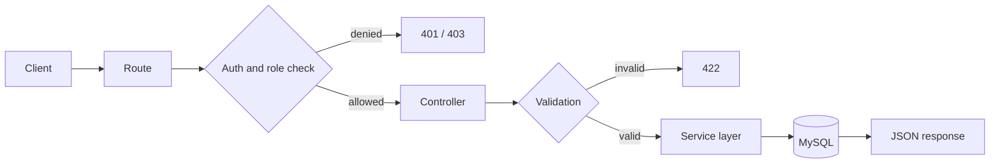

<!-- ## Hi there 👋 -->

<!--
**Dikanrulhdyt/Dikanrulhdyt** is a ✨ _special_ ✨ repository because its `README.md` (this file) appears on your GitHub profile.

Here are some ideas to get you started:

- 🔭 I’m currently working on ...
- 🌱 I’m currently learning ...
- 👯 I’m looking to collaborate on ...
- 🤔 I’m looking for help with ...
- 💬 Ask me about ...
- 📫 How to reach me: ...
- 😄 Pronouns: ...
- ⚡ Fun fact: ...
-->
<!-- HEADER ANIMATION -->
<h1 align="center">Hi 👋, I'm Dika Nurul Hidayat</h1>
<h3 align="center">🚀 Backend Developer | Informatics Student | Tech Enthusiast</h3>

  

---

## 🧠 About Me
- 🎓 Informatics Student (Semester 5)
- 💻 Focused on **Backend Development & Database**
- ⚙️ Experienced in building **REST APIs & System Integration**
- 🤖 Interested in **Artificial Intelligence & ERP Systems**
- 🚀 Currently improving **scalable system architecture**

---

integration
🛠️ Tech Stack
💻 Backend & Programming

  

🗄️ Database

  

🌐 Frontend

  

🧰 Tools

  

🤖 Others

     

---

## 📊 GitHub Stats

  
  

---

## 🔥 Streak Stats

  

---

## 🧭 How I Build
 
1. **Data first.** I sketch the ERD before writing endpoints, because a clear model saves a lot of rewriting.
2. **Document as I go.** Each project gets a README with setup steps, an endpoint list, and a diagram.
3. **Treat input as hostile.** Validate everything, hash secrets, and give each role only the access it needs.
4. **Test the unhappy path.** A good API answers `401`, `403`, `404`, and `422` just as clearly as `200`.
5. **Small commits, clear messages.** The history should tell the story of the project.
A typical request flow in my API projects:
 

 
---
 
## 🧩 Featured Projects
 
| Project | What it explores | Stack / Focus |
|---|---|---|
| 💰 **REST API Financial System** | Register, login, transfer, top-up, and reporting endpoints | Authentication · transactions · reporting |
| 🤖 **Focusflow AI** | A productivity app where an LLM helps prioritise tasks | NestJS · TypeScript · React · Gemini API |
| 🛒 **Purchasing Order App** | Role-based access, social login, 2FA, online payment, dynamic reports | Laravel · MySQL · Midtrans · Chart.js |
| 📈 **IPO Prediction** | Serving a machine-learning model to a web app through an API | Python · Node.js · React |
| 🥋 **Pencak Silat Management App** | Training and participant administration, built with a team | Laravel · UAT · blackbox testing |
| 🏥 **Hospital Management System** | Patient, doctor schedule, and inventory data across several roles | System analysis · ERD · DFD |
| 🚀 **Online Voting System** | Turning voting rules into a secure, auditable flow | System analysis · flowmap · ERD |
 
> 📌 Pinned repositories show the code. This table is the short story behind each one.
 
---
 
## 🌱 Currently Levelling Up
- ✅ Automated testing for APIs (unit and feature tests)
- 📘 API documentation with OpenAPI / Swagger
- 🐳 Docker basics and deploying a small app end to end
- 🔐 Security fundamentals: OWASP Top 10, token handling, rate limiting
- 🧱 System design: caching, queues, and scaling basics

---

## 🎯 Current Goals
- 🚀 Become Professional Backend Developer
- 📈 Master System Design & Scalability
- 💼 Start Freelance Career
- 🌐 Build Impactful Projects

---

## 📫 Connect With Me

  
  
  

---

## 🐍 Contribution Snake

  

---

## ⚡ Fun Fact
> 💡 I love building systems, optimizing workflows, and turning ideas into real applications 🚀
